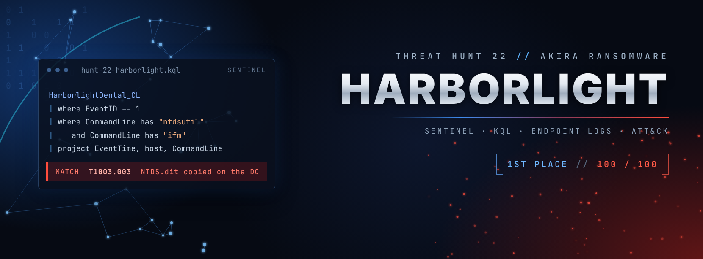

  

## Hunt 22 - Threat Hunt Brief

### **Harborlight Dental & Insurance // ransom notes in every shared folder, and nobody was watching**

**🏆 1st place of 20 hunters // report score 100 / 100**

---
### **CASE BRIEF**

**CASE BRIEF // Pacific Watch SOC**

**Client:** Harborlight Dental & Insurance, a small dental and insurance practice
**IT support:** Coastal MSP, a five-person IT contractor covering the whole footprint
**Re:** Akira-style ransomware, full intrusion reconstruction

> *"We found ransom notes in every shared folder this morning. Nobody was watching any of this. Our MSP says the logs are all there but nobody ever looked at them. We need to know everything that happened."*
> **Harborlight Dental & Insurance // Incident report // 04 Feb 2026**

Staff found ransom notes on the morning of 4 February and reported it cold. Nothing paged, nothing escalated. Full endpoint and Windows Security logging exists across all three machines, unreviewed until now. Reconstruct the full intrusion from raw telemetry, host by host, initial access through impact.

**Threat intel:** Akira, a double-extortion ransomware operation active since early 2023. It targets small and mid-size organisations with flat networks, weak segmentation and limited monitoring, and exfiltrates data before encrypting, using tools like rclone to stage to cloud storage.

---
### TL;DR

One employee opened a fake invoice attachment. Within three and a half hours the attacker had the workstation, the file server and the domain controller. They copied the shared drive to MEGA, destroyed the backups, copied the Active Directory database, wiped the logs and encrypted files on all three machines. Thirteen hours after the ransom notes appeared, the backdoors were still calling home. It was not over.

📄 **[Investigation Report (PDF, TLP:CLEAR)](harborlight-hunt-report.pdf)**

---
### Hunt at a glance

| | |
|---|---|
| **Threat** | Akira-style ransomware (TTP match, not an attribution) |
| **Environment** | 3 Windows hosts on one flat network: BACKOFFICE-PC1 (workstation), HL-FS01 (file server), ADDC01 (domain controller) |
| **Platform** | Microsoft Sentinel, KQL |
| **Data source** | `HarborlightDental_CL` (endpoint process, network, file, registry and DNS events, plus Windows Security logons, account changes and log clears) |
| **Window** | 4 Feb 2026, first lure 01:57 UTC, backdoors still active at 18:47 UTC |
| **Method** | Hypothesis-driven, intel-informed reconstruction (PEAK + TaHiTI) |
| **Report** | 86 pages: one-page summary, 16 findings, 16 negative findings, 52 numbered queries, 77 evidence screenshots, 18 tested detections |

---
### Kill chain

| Time (UTC) | Stage | What happened |
|---|---|---|
| 01:57 | Initial access | Invoice-themed archive downloaded; an ISO inside runs `review.dll` through rundll32. A second, company-branded lure at 02:24 gets the first C2 callback. |
| 02:42 | Privilege escalation | Silent fodhelper UAC bypass launches a fake `taskhostw.exe` from `C:\Users\Public` at High integrity. |
| 02:50 | Credential access | The implant injects into the print spooler, which dumps LSASS. A domain password is later used in clear text. |
| 03:34 | Lateral movement | Admin shares and WMI to the file server, then the domain controller. The DC then sends commands back down to the other hosts. |
| 03:58 | Exfiltration | rclone renamed to `MsMpEng.exe` copies `C:\Shares` to MEGA. |
| 04:04 | Anti-recovery | `update.bat` disables Defender and the firewall, stops about 60 services, then deletes shadow copies, the backup catalog and boot recovery. |
| 04:33 | Credential access (DC) | `ntdsutil` IFM copies the Active Directory database (NTDS.dit). |
| 05:13 | Impact | `updater.exe` drops 128 ransom notes and encrypts files; event logs wiped on every host. |
| 05:22 | Persistence | Backdoor account `svc_sql` added to Domain Admins; three backdoor binaries, a Run key and a scheduled task in place. |
| 18:47 | Still active | Backdoors on the DC still calling home. A responder's logon on the file server at 13:45 had relaunched another. |

---
### MITRE ATT&CK coverage

30 techniques observed across 11 tactics. Full evidence references are in Section 11 of the report.

| Tactic | Techniques |
|---|---|
| Initial Access | T1566 Phishing |
| Execution | T1204.002 User Execution: Malicious File · T1047 WMI · T1059.001 PowerShell |
| Privilege Escalation | T1548.002 Bypass UAC · T1055 Process Injection · T1098 Account Manipulation |
| Defense Evasion | T1553.005 Mark-of-the-Web Bypass · T1218.011 Rundll32 · T1036.005 Masquerading · T1562.001 Disable or Modify Tools · T1562.004 Disable or Modify System Firewall · T1070.001 Clear Windows Event Logs · T1070.004 File Deletion |
| Credential Access | T1003.001 LSASS Memory · T1003.003 NTDS |
| Discovery | T1018 Remote System Discovery |
| Lateral Movement | T1021.002 SMB/Windows Admin Shares · T1570 Lateral Tool Transfer · T1078.002 Domain Accounts |
| Persistence | T1547.001 Registry Run Keys · T1053.005 Scheduled Task · T1136.002 Domain Account |
| Command and Control | T1071.001 Web Protocols · T1090.004 Domain Fronting · T1105 Ingress Tool Transfer |
| Exfiltration | T1567.002 Exfiltration to Cloud Storage |
| Impact | T1490 Inhibit System Recovery · T1489 Service Stop · T1486 Data Encrypted for Impact |

---
### Detections

Eighteen behaviour-based rules, each tested against the hunt data. Three failed their first test and were fixed, and the fixes are documented. Full KQL is in Appendix A of the report.

| ID | Detection | ATT&CK | Result on the hunt data |
|---|---|---|---|
| D1 | rundll32 loading a DLL from a mounted or user path | T1218.011 | 4 hits, all attacker |
| D2 | ms-settings handler hijack | T1548.002 | 4 hits, all attacker |
| D3 | Full-access handle to LSASS | T1003.001 | 9 hits, all attacker; SearchIndexer correctly excluded |
| D4 | Injection into a service or trusted process | T1055 | 8 hits, all attacker |
| D5 | ntdsutil IFM | T1003.003 | 4 hits, all attacker |
| D6 | Event-log clearing | T1070.001 | 7 bursts, all attacker |
| D7 | Recovery inhibition | T1490 | 13 hits, all attacker |
| D8 | rclone-style cloud exfil, any port | T1567.002 | 42 hits, all attacker |
| D9 | Privileged group change | T1098, T1136.002 | Fixed after first run; 1 window, attacker |
| D10 | Windows binary name from the wrong folder | T1036.005 | Widened after first run; 6 of 6 binaries |
| D11 | Admin-share or remote-WMI lateral movement | T1021.002, T1047 | 4 hits, all attacker |
| D12 | Beaconing to one external IP | T1071.001 | 14 rows, all attacker backdoors |
| D13 | File dropped into a Startup folder | T1547.001 | 4 hits, all attacker |
| D14 | Network activity from a binary with no process-create | Telemetry gap | 3 attacker, 2 benign (tuning noted) |
| D15 | Host going silent for over 30 minutes | T1070 | No hits; telemetry unbroken |
| D16 | Two or more detections on one host within an hour | Correlation | Would have paged at 02:40, before the LSASS dump |
| D17 | Service-stop or process-kill burst | T1489 | 3 bursts, all attacker |
| D18 | Defender or firewall tampering | T1562.001, T1562.004 | 44 hits, all attacker |

**Deploy first:** D16, D3, D6 and D8. One day on three hosts is not a production false-positive rate, so each rule should run silently against a week of baseline before it alerts.

---
### Lessons learned

- **The ransom note is not the end.** The attacker kept three backdoors and a Domain Admin account, and a responder's own logon relaunched one of them.
- **Scope past the logs you have.** The attacker touched four more hosts over SMB, including the email server, and none of them send telemetry.
- **Write down what you ruled out.** Sixteen negative findings show what was checked and not found, not just what was found.
- **Make the depth easy to enter.** The report now opens with a one-page summary a CISO, lawyer or insurer can act on.

---
### Investigation Report
[Investigation Report (PDF)](harborlight-hunt-report.pdf)
